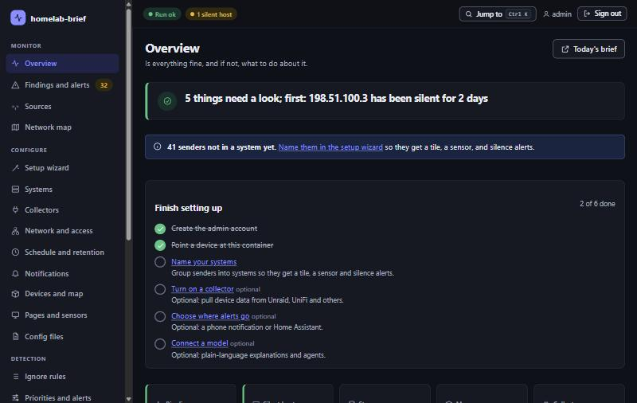

<div align="center">


# Homelab Brief

### A daily news-style brief, and live status, for everything your network and homelab are doing


**Status:** **early (0.0.x), one maintainer.** It runs on its author's own staging server and is covered by
over 1,800 automated tests, an end-to-end suite against the real image, and an upgrade test between
releases. The Unraid collector, the syslog pipeline, and the admin console are proven on a live server;
the other collectors are proven against simulated devices only (see
[Known limitations](#known-limitations)). Try it next to your real setup, not instead of it.



</div>

---

## What & why

Your router, switches, access points, NAS, and servers all log somewhere you never read. Homelab Brief
is one container that receives those logs and polls your gear's APIs, learns what *normal* looks like
for every host and every kind of message, and tells you what changed: a short brief each morning, alerts
that don't nag, and a status page that says in five seconds whether everything is fine.

- **In scope:** syslog collection · API collectors (Unraid, UniFi, SNMP, iDRAC, Home Assistant power) ·
  baselines and detectors (new, unusual, gone silent) · a daily brief and weekly report · MQTT sensors
  with Home Assistant discovery · Prometheus `/metrics` and a read-only REST API · static pages for
  tablets and e-readers · an admin console, a CLI, and optional AI.
- **Not in scope:** being a full SIEM, packet capture, reaching the internet, controlling your devices
  (it suggests, it never acts), multi-user accounts or single sign-on (one admin today).
- **Hard constraints:** the pipeline runs with **no AI and no internet** · AI never decides, acts, or
  waits on · a cloud AI model **never** sees device-level data, raw log lines, or DNS · the status pages
  and API are **read-only** · every admin change is **audited** · no personal data in this repository
  (a guard in CI enforces it). The rules are written down in [`AGENTS.md`](AGENTS.md).

> [!NOTE]
> **AI is off by default.** Turn it on and the brief is rewritten in plain prose by any OpenAI-compatible
> model (a local GPU box or a hosted service), with the rule-based brief as the fallback and the source of
> truth. A read-only MCP server lets an assistant query the same facts. See
> [`docs/guide/09-ai-integration.md`](docs/guide/09-ai-integration.md).

## How it fits together

```
  your devices ──── syslog (UDP/TCP 514) ───┐
  (router, switches, APs, NAS…)             │     ┌─────────────────────────────────────┐
                                            ├────►│  Vector ──► worker                  │──► MQTT / Home Assistant
  Unraid · UniFi · SNMP · iDRAC · HA APIs ──┘     │  baselines · detectors · alerts     │──► /metrics  /api/v1
        (collectors poll these)                   │  SQLite + raw archive               │──► status page · brief.html
                                                  └──────────────┬──────────────────────┘      · tablet board
                                                  admin console (HTTPS) · `brief` CLI · optional AI · MCP
```

One image (`ghcr.io/herbiewalker/homelab-brief`), one container, one appdata folder. It needs about 770 MB of
memory at most and no headless browser.

## ⚡ Quickstart

Prerequisites: Docker with the compose plugin, and a machine that can receive syslog from your devices.

```bash
mkdir homelab-brief && cd homelab-brief
curl -fsSLo compose.yaml https://raw.githubusercontent.com/herbiewalker/homelab-brief/main/deploy/docker-compose.quickstart.yml && docker compose up -d
docker compose logs homelab-brief | grep setup_token
```

The last command prints the one-time admin link (`https://<this-host>:8443/admin/setup`; the certificate is
self-signed, so your browser warns once). Create the admin account and follow the setup wizard. Then point
one device's syslog at `<this-host>:514` and it appears on the Sources page within a minute. Data lives in
`./homelab-brief-data`. If port 514, 8080, or 8443 is taken, put `HB_SYSLOG_PORT`, `HB_HTTP_PORT`, or
`HB_HTTPS_PORT` in a `.env` file first; the header of the compose file lists every setting.

**On Unraid** (Docker tab, with one-click updates): run this once in the Unraid terminal, then Add Container,
pick `homelab-brief` from the Template dropdown, set a fixed IP on `br0`, and apply:

```bash
wget -O /boot/config/plugins/dockerMan/templates-user/my-homelab-brief.xml https://raw.githubusercontent.com/herbiewalker/homelab-brief/main/deploy/unraid-template.xml
```

The image follows the `stable` tag, so the Docker tab offers **Update** when a release is out. Every start
keeps a copy of the database before it migrates.

> [!IMPORTANT]
> The quick start publishes ports on the host. On Docker Desktop, or for logs from the Docker host itself,
> Docker can replace every sender's address with the bridge gateway, so all devices look like one; the
> console's Network page warns when it sees that. An own LAN address (macvlan) avoids it but means the host
> cannot reach its own container without a Docker setting. Both trade-offs, and the other network modes, are
> in [`deploy/README.md`](deploy/README.md).

## Usage

- **See what's happening:** the Overview (admin console) and the public status page at `/`. Click a system
  to see each device in it by name, with its model, firmware, and last line.
- **Read the brief:** `/brief.html` each morning; the tablet board is `/board.html`. The brief opens with the
  few things worth your attention and keeps everything else below.
- **Tune it:** *Findings and alerts* to acknowledge or snooze, *Ignore rules* to silence a noisy message
  (with a preview of what that would have hidden last week), *Thresholds* for when detectors fire. Every
  setting is a form; "Edit as text" is always there, with history and rollback.
- **From a terminal:** `docker exec homelab-brief brief --help`. Every admin action has a command.
- **Connect it:** MQTT and Home Assistant, push notifications, collectors, and AI are each switched on in the
  console when you want them; nothing phones out until you say so.

## 🗂️ Documentation map

| Doc | What it owns |
|-----|--------------|
| [`deploy/README.md`](deploy/README.md) | installing, network modes, upgrading, backup and restore, rollback |
| [`docs/project-plan.md`](docs/project-plan.md) | what it is for, the outputs, the phases |
| [`docs/unraid-backend-guide.md`](docs/unraid-backend-guide.md) · [`docs/guide/`](docs/guide/) | the technical guide: collection, baselines, the brief, publishing, collectors, the map, access, AI, agents, the console |
| [`docs/DECISIONS.md`](docs/DECISIONS.md) | why things are the way they are, and what is still open |
| [`docs/TASKS.md`](docs/TASKS.md) | the build backlog and what shipped |
| [`CHANGELOG.md`](CHANGELOG.md) | every release |
| [`AGENTS.md`](AGENTS.md) | the rules for contributors and coding agents |
| [`SECURITY.md`](SECURITY.md) · [`CONTRIBUTING.md`](CONTRIBUTING.md) | reporting a vulnerability, sending a change |

## Known limitations

Deferred issues and accepted trade-offs, listed so they are visible:

- **Only the Unraid collector has run against a real server.** The UniFi, SNMP, iDRAC, and Home Assistant
  collectors were built against simulated devices that mimic the real APIs; SNMPv3 and UniFi client and
  traffic data are unproven. Expect a real-device surprise.
- **The AI layer and agents are lightly exercised** (one small local model and scripted models), and the MCP
  server has not met a real MCP client.
- **A container on its own IP can't monitor its own host** without enabling Docker's "host access to custom
  networks". A fix that needs no network setting (read-only mounts of the host's own log and state files) is
  planned.
- **One admin account**, no single sign-on, and `amd64` images only.
- **The network map is basic** (view and a simple editor); a modern editable map and NetFlow are planned.
- **Not yet listed in Community Applications**; the template install above works today.

## Privacy and security

Everything runs on your network. The admin console needs a login over HTTPS, every write is protected against
cross-site requests and recorded in an audit log, and passwords are hashed with Argon2. Per-device activity
stays local: a cloud AI provider only ever sees system-level facts. Secrets come from container variables,
never from files in the repository. Report a vulnerability as described in [`SECURITY.md`](SECURITY.md).

## Contributing

Issues and pull requests are welcome; start with [`CONTRIBUTING.md`](CONTRIBUTING.md). The one hard rule: this
repository holds the generic product only, so no real hostnames, addresses, MACs, names, or log lines, ever.

## License

AGPL-3.0, see [`LICENSE`](LICENSE). If you run a modified version for others over a network, the AGPL asks you
to offer them your modified source; the console footer links to this repository for that reason. The
vendored front-end files (htmx, Alpine.js, Cytoscape.js) and the other components that ship in the image keep
their own permissive licences, listed in
[`brief/src/brief/static/vendor/VENDOR.md`](brief/src/brief/static/vendor/VENDOR.md) and in
[`docs/DECISIONS.md`](docs/DECISIONS.md).
